# aiphoto 安卓客户端开发需求

文档状态：需求草案，供后续开发拆分与验收使用。  
制定日期：2026-11-16。  
代码基线：`6e31283`，应用版本 `0.21.4`。  
已明确约束：不需要备份手机相册。

## 1. 产品定位与目标

开发连接现有 aiphoto 私有部署服务的安卓原生客户端，让用户在手机上浏览 NAS 中的照片和视频，使用本地 AI 搜索、人物分类和相册整理功能。

照片原件、媒体索引、AI 推理、人脸数据仍保存在 NAS。手机只保存登录凭据、用户偏好、必要的列表与图片缓存，以及用户主动下载的文件。客户端不直接连接 PostgreSQL 或 AI 服务。

核心用户场景：

1. 在家通过局域网打开相册，快速浏览新入库照片。
2. 在外通过用户已配置的 HTTPS 地址或 VPN 查看照片。
3. 用自然语言、日期、人物、标签找到目标照片。
4. 全屏看图、播放视频、查看拍摄信息，收藏并整理照片。
5. 查看家人照片、宝宝成长照片与精选时间线。
6. 将单张或少量照片主动下载到手机，或通过安卓分享面板发送给其他应用。

### 1.1 明确排除的范围

- 手机相册备份，包括自动备份、手动批量备份和定期备份。
- 扫描手机 DCIM、相册目录，监听拍照或新增媒体事件。
- 后台自动上传、双向文件同步、删除联动、手机空间释放。
- 首版手动上传入口；以后确有单文件上传需求时另行制定。
- 首版申请读取全部手机照片、视频或“所有文件访问”权限。
- 手机端运行 CLIP、InsightFace、YOLO 或 BLIP 模型。
- 自动配置路由器、端口映射、NAS 外网穿透或 VPN。
- 首版编辑照片像素、裁剪、滤镜、视频剪辑、投屏、桌面小组件。

“缓存”仅用于加速浏览，不等于备份或完整离线相册；“下载”仅由用户主动触发。

## 2. 优先级与交付阶段

| 阶段 | 目标 | 必须交付 | 进入下一阶段的条件 |
| --- | --- | --- | --- |
| M0：接口准备 | 核实服务端能力与数据边界 | 接口契约、媒体鉴权方案、权限规则、分页补充、测试环境 | 核心接口可联调，权限行为可验证 |
| M1：首版 | 日常浏览、搜索和整理闭环 | 服务连接、登录、图库、图片查看、视频、搜索、普通相册、收藏、人物只读、下载分享、回收站恢复、设置 | 首版验收用例全部通过 |
| M2：家庭功能 | 发挥现有项目特色 | 精选时间线、宝宝相册、人物整理、标签与分类维护 | 对应服务端接口和数据规则完整 |
| M3：管理扩展 | 手机上查看任务和维护相册 | AI 任务、目录扫描状态、去重审阅、采集任务简化管理 | 按实际需求逐项选择实施 |

P0 表示 M1 发布必需，P1 表示 M2，P2 表示后续按需扩展。安全、权限、数据一致性及无备份约束属于各阶段共同要求。

## 3. 账户、数据与权限边界

### 3.1 数据归属

现有项目不能直接视为“每个账户独享一套私有相册”：部分照片接口没有按当前账户过滤，收藏、评分、备注等保存在照片实体上。客户端必须先按实际规则呈现，不能仅靠界面隐藏实现隔离。

建议首版沿用同一 NAS 家庭共享图库模式，同时要求：

- 服务端明确谁可以浏览、修改、移入回收站、恢复和永久删除。
- 展示偏好按账户保存，缓存按“服务器实例 + 账户”隔离。
- 收藏、评分、备注暂沿用现有图库级语义，在产品说明中明确；若改为个人收藏，需单独调整服务端关联表、查询及 Web 端行为。
- 管理员与普通用户的实际可用操作，以后端权限结果为准。
- 正式开发前确认共享图库模式；如要求个人私有图库，应先补服务端资源授权，不能作为安卓端局部改动处理。

### 3.2 首版权限建议

| 操作 | 首版建议 |
| --- | --- |
| 浏览、搜索、下载、系统分享 | 已登录且具有资源访问权限的用户 |
| 收藏、评分、备注、普通相册维护 | 具有图库编辑权限的用户 |
| 移入回收站、恢复 | 具有删除/恢复权限的用户 |
| 永久删除、清空回收站、全量 AI 重建 | 首版不提供入口；以后仅限管理员并由服务端校验 |
| 服务器配置、账户管理、模型管理 | 继续通过 Web 管理端完成 |

以上为目标权限规则，不代表当前后端已完整实现。

## 4. 页面与导航

底部悬浮滑块包含四个入口，依次为**照片、相册、发现、采集**。

| 入口 | 内容 | 二级页面 |
| --- | --- | --- |
| 照片 | NAS 图库、搜索入口、多选整理 | 全屏查看器、详情、筛选 |
| 相册 | 普通相册；后续展示宝宝等类型 | 相册详情、创建/编辑、选图 |
| 发现 | 人物、标签/分类入口；后续精选时间线 | 人物详情、标签结果、成长时间线 |
| 采集 | 点击「采集」打开采集中心概览 | 任务、待整理、全屏预览 |

照片页标题栏右侧仅显示放大镜图标，与标题同一行，点击进入独立搜索页面。搜索图标右侧的三点更多按钮仅显示图标，点击直接进入「我的」，可访问收藏、回收站、下载记录、账户与设置。全屏查看器为共用页面，从图库、相册、搜索和人物页进入时保留原列表上下文。

首版中文界面，文案集中管理，为后续多语言预留条件。采用安卓操作习惯，适配系统返回、手势导航、安全区域、状态栏及深色模式。

## 5. P0 功能需求

### 5.1 服务器连接

- 首次打开要求输入服务地址，支持局域网 IP、域名、端口和反向代理路径前缀。
- 保存前进行连通性及服务兼容性检查，区分 DNS、超时、证书、地址错误及非 aiphoto 服务。
- 显示服务器名称、应用版本、当前地址和可用能力。
- 首版仅激活一个服务器与一个账户；可保存多条连接配置，切换时暂停旧会话请求和下载，清除旧界面状态。
- 支持用户主动修改地址；不能根据同名域名或相同账户名自动认定为同一服务器。
- HTTPS 为推荐连接方式；局域网 HTTP 需显式启用并告知凭据与媒体传输未加密。不得自动绕过证书验证。
- 自签证书默认显示可信配置指引，不提供全局“忽略证书”开关；用户 CA 或单实例信任方案作为后续专项评估。
- 内外网自动地址切换、二维码连接与局域网发现列为 P2。

验收：带路径前缀的服务能够登录、加载缩略图和播放视频；地址不可达时可修改连接配置；失败不能清空已有配置。

### 5.2 登录与会话

- 使用现有用户名、密码登录；首版不开放客户端注册。
- 记住服务器与用户名，密码不落盘；令牌使用安卓安全存储方案，密钥由 Keystore 保护。
- 支持查询当前用户及角色；会话过期后集中处理 401，避免多个页面重复跳转。
- 当前接口没有发现刷新令牌能力，首版允许重新登录续期；自动刷新列为可选服务端增强。
- 登录过期时保留服务器和当前页面意图，重新登录成功后恢复可恢复的浏览位置。
- 退出登录取消请求、停止媒体播放、暂停下载、清除令牌和该会话私有缓存。
- 已导出到公共下载目录的文件不能因退出而静默删除；在下载说明中明确这些文件由用户管理。

验收：多个请求同时收到 401 只出现一次登录流程；切换账户后不闪现上一账户缩略图或详情。

### 5.3 照片图库

- 默认按“最近入库”展示，复用现有按 ID 倒序的游标接口，不将其误标为拍摄时间排序。
- 支持分页加载、下拉刷新、失败重试、空图库引导及返回位置恢复。
- 向上滚动时，照片图库标题向上退出，原位显示当前可见日期分组的入库日期。日期随顶部可见分组更新，回到顶部恢复图库标题。日期和搜索图标悬浮在照片内容上方，照片可滚动经过下方。搜索图标保持在右上角，滚动后半透明并可点击。
- 瀑布或规则网格优先采用规则网格，支持 3/4/5 列；记录账户偏好。
- 照片和视频按同一顺序混排在图库网格中。单元格显示缩略图、媒体类型和收藏状态，视频缩略图叠加播放标识，服务端提供时长时一并显示。
- 仅请求可见区域与少量预取项；滚动离开时取消低优先级加载。
- 点击照片进入看图，点击视频缩略图直接进入播放器并开始播放。长按进入多选，支持选择当前已加载项、取消选择、批量收藏和加入相册。
- “全选”明确限定为当前已加载项，首版不支持跨全库隐式全选。
- 批量处理按项记录成功与失败，失败项可重试，不能只显示一条笼统的成功提示。
- 拍摄日期排序、按年月快速跳转作为 P1，依赖对应排序游标或日期定位接口。

验收：连续加载时无重复项；并发新增照片后刷新能够看到；删除后返回位置合理；某张缩略图损坏不阻塞整页。

### 5.4 图片查看器与详情

- 全屏显示，左右翻页，单击显示/隐藏工具栏，双击缩放，双指缩放与拖动。
- 先显示缩略图，再请求适合屏幕的预览，用户可主动查看原图。
- 大图使用降采样或分块解码，避免直接将超高分辨率原图完整载入内存。
- 翻页到分页边界继续拉取；返回原页面恢复滚动位置、筛选和选择状态。
- GIF 列表默认静态展示，仅当前详情项播放动画。
- RAW 首版保证可用预览图展示及原文件下载，不承诺手机原生解码所有 RAW。
- HEIC、超大图、缺失预览等情况提供明确降级提示；实际格式支持以验收媒体集为准。
- 详情显示文件名、类型、尺寸、大小、拍摄日期、入库日期、评分、备注、AI 描述、标签、关联人物；空字段不伪造内容。
- GPS 首版只显示已有坐标或文本信息，不默认调用第三方地图服务。
- 支持收藏、取消收藏、修改评分和备注、加入相册、移入回收站。
- 评分范围及“未评分”的表达与服务端统一；部分更新不得把未编辑字段重置。
- 点赞沿用现有独立计数行为。发现页支持浏览点赞照片，首版暂不提供新增或撤销点赞操作。

验收：连续浏览大图不崩溃；旋转屏幕后保留当前照片；收藏请求失败恢复原状态；GPS、AI 描述不发送给外部分析服务。

### 5.5 视频播放

- 点击后播放，不在图库中自动播放或预加载完整视频。
- 支持播放/暂停、进度拖动、横竖屏、全屏、音量与播放错误提示。
- 首版切到后台暂停播放，不增加后台播放常驻服务。
- 从查看器翻到其他项时停止上一视频，释放播放器资源。
- 优先支持经实机验证的 MP4/H.264/AAC 组合；HEVC、MOV 等按设备解码能力验证。
- NAS 媒体链路必须支持字节 Range 和正确的内容类型；客户端不得为一次拖动重新下载完整文件。
- 不支持的编码显示格式信息及下载入口；服务端转码、字幕、投屏列为 P2。

验收：至少验证正常播放、拖动、断网、恢复、退出与不支持编码；弱网情况下可取消加载，无无限等待。

### 5.6 搜索与筛选

- 提供“关键词”和“AI 语义”两种模式，并说明语义搜索依赖 NAS AI 服务。
- 关键词条件支持项目现有查询；不承诺当前系统已有 OCR 或图片中文字搜索。
- 筛选包括日期范围、人物、标签、文件类型、最低评分；其他条件在确认现有接口语义后逐项启用。
- 显示当前条件，支持单项移除与一键重置；结果分页加载，可进入查看器。
- 用户明确提交后执行搜索；取消上一未完成请求，避免旧结果覆盖新条件。
- 搜索历史只存于当前服务器和账户范围，支持关闭和清空。
- AI 不可用、索引未完成、无结果、网络错误分别展示；不得把语义失败解释为无匹配照片。
- 中文语义检索质量需真实图片集验证，不承诺自然语言一定精确命中。

验收：组合条件按后端规则交集生效；反复切换查询无旧结果回流；AI 故障时关键词检索仍可使用。

### 5.7 普通相册

- 展示封面、名称、照片数量、类型；详情分页浏览。
- 创建、重命名、修改描述、设置封面、添加或移除照片、删除普通虚拟相册。
- 从相册移除照片只删除关联；删除相册不删除图库原件，确认弹窗必须说明影响。
- 目录、训练和宝宝等类型不能套用普通相册的编辑规则；首版按能力只读，宝宝功能进入 M2。
- 封面图被移入回收站或失效后显示默认封面或服务端新封面。
- 手机选图指从 NAS 图库选择，不调用手机相册选择器。
- 现有相册照片接口返回完整数组，首版正式发布前需新增兼容的分页接口。

验收：大相册按页加载；重复添加不重复关联；删除相册后原件仍可在图库浏览。

### 5.8 人物与发现

- 发现页的人物区使用单行横向滑动的封面卡片。交互原型展示 8 张人物卡片。姓名以透明悬浮标签叠在封面左下角。人物标题行右侧的箭头进入全部人物页，以每行四张的网格显示所有人物封面。点击任一入口的人物封面进入对应照片列表，顶部从左到右显示返回按钮、人物名称和小字号照片总数，下方显示分页照片网格。
- 发现页的「家庭记忆」使用两张并排的圆角封面，左下角叠加标题，点击分别进入精选时间线和宝宝相册。
- 未命名人物显示统一占位名称；人物不存在或被合并时可返回列表。
- 人物识别仍在 NAS 完成，不上传手机联系人或请求摄像头权限。
- 标签和分类优先提供只读入口及对应照片结果；照片分类、人物不全时明确识别仍可能在处理中。
- 人物改名、合并、封面选择、错误人脸归属修正列为 P1，且必须有服务端权限检查。

验收：从人物进入照片后返回能恢复人物页；人物详情无照片时有空状态。

### 5.9 收藏、删除与回收站

- 提供收藏列表，与全屏查看器和图库同步更新。
- 发现页人物区下方展示「收藏」栏，前 10 张收藏照片以单行缩略图横向滑动。点击缩略图或标题行右侧箭头进入完整收藏照片列表，点击列表内照片打开全屏看图。
- 「点赞」栏位于收藏栏下方，沿用同样的横滑和列表跳转交互，显示前 10 张点赞照片。点赞列表与个人收藏分别展示。
- 首版删除入口只执行 NAS 图库“移入回收站”，不操作手机文件。
- 弹窗明确这会影响共享图库及其他客户端；提交中防止重复操作。
- 回收站支持分页查看、单项或多项恢复；展示删除时间及服务端已知的保留规则。
- 首版不提供永久删除和清空回收站；服务端自动清理策略必须在界面说明中准确反映。
- 现有删除逻辑会清除收藏、时间线标记及部分封面引用；恢复是否恢复这些关系需核对，不承诺完整恢复原状。
- NAS LINK/COPY 存储模式对最终物理文件的影响由服务端确定，安卓端不得自行推断。

验收：恢复后照片重新可见；部分批量失败保留失败项；无权限操作返回明确提示。

### 5.10 下载与系统分享

- 支持单个原文件下载、少量多选下载，展示文件名、大小、进度、完成/失败状态。
- 下载为用户主动操作，不创建定时任务、不枚举手机媒体、不进行后台自动同步。
- 下载前校验网络及可用空间，蜂窝网络下载大文件时提示确认。
- 首版允许失败后重新下载；断点续传仅在 ETag/Last-Modified、Range 等服务端条件验证后实现。
- 系统分享使用临时 content URI 和最小读取授权，不能把 NAS 内部路径、令牌或未经授权可访问的永久地址发给其他应用。
- 分享前按需下载到临时目录；用户取消分享后按缓存清理规则回收文件。
- 原图可能包含 GPS 等元数据，选择“分享原文件”时提示；移除元数据的分享副本列为 P1。
- 导出使用系统存储接口和用户选择的保存位置，不索要全盘访问权限。

验收：收到文件的应用可以读取，其他应用不能枚举私有缓存；下载失败不会留下显示为完成的破损文件。

### 5.11 设置、缓存与离线

- 设置项：跟随系统/浅色/深色、网格列数、移动网络原图策略、缓存上限、搜索历史、服务器地址、账户、退出。
- 首版缓存上限建议默认 512 MiB，可配置并手动清理；预览缓存不得无限增长。
- 展示偏好归属账户；路径、证书信任等归属服务器实例；流量策略和缓存大小归属当前设备。
- 跨设备偏好同步仅复用已明确兼容的账户字段，新增安卓专属偏好时采用独立命名空间。
- 无网络时可查看已缓存的列表和缩略图，显示“离线缓存”与最后刷新时间。
- 首版离线只读；收藏、备注、删除等操作需联网，不构建后台修改同步队列。
- 缓存不能被描述为可靠离线收藏；用户清缓存或系统回收后可消失。
- 关于页展示客户端版本、服务端版本、接口兼容状态及开源许可。

验收：离线启动可进入已缓存内容；清缓存不删除用户主动导出的文件；账户切换不会混用缓存。

## 6. P1 家庭与整理功能

### 6.1 精选时间线

复用 `inTimeline` 与现有按月摘要、按月照片接口。区分“全部照片按拍摄时间浏览”与“用户选入时间线的照片”，不能将两者混为一页数据。支持按年/月定位、进入查看器、添加/移出精选；日期缺失项单独展示或明确不参与的规则。

### 6.2 宝宝相册

- 新建宝宝相册，配置名称、出生日期、封面；不默认自动关联某个人物。
- 按出生前、天龄、月龄、年龄分组，采用服务端统一算法，明确时区和缺失拍摄日期的归类。
- 支持浏览、选入照片、移除关联、修改出生日期后重新分组。
- 成长里程碑、文字记录、年度成长影片列为独立后续需求，不假定当前后端支持。
- 当前 Web 页面调用 `/api/albums/{id}/baby-timeline`，但本次检查未发现控制器对应映射；已有 `BabyAlbumService` 不等于端到端可用。进入 M2 前补齐接口、分页及日期边界验证。

### 6.3 人物、标签和分类整理

支持人物改名和封面选择，后续增加合并和归属修正。合并前展示影响范围并二次确认；不可逆操作说明是否有恢复能力。标签支持按现有接口维护，区分人工标签与 AI 结果，避免人工修改被重建任务无提示覆盖。

### 6.4 原件分享隐私

增加“分享副本并去除位置”等选项，保留原件不修改；验证旋转方向、色彩及目标格式，不能仅删除 GPS 字段就承诺已消除全部隐私元数据。

## 7. P2 管理能力候选

| 模块 | 手机端建议范围 | 前置条件 |
| --- | --- | --- |
| AI 任务 | 查看状态、进度、失败原因，按权限重试 | 状态接口稳定，重试操作幂等 |
| NAS 目录 | 查看已配置目录、扫描进度，按权限触发扫描 | 不让手机路径与 NAS 路径混淆 |
| 去重审阅 | 对比相似照片、选择保留项、移入回收站 | 明确重复规则、可恢复与权限 |
| 网页采集 | 采集概览、任务与待整理照片审阅 | 0.26.0 实现，见 §7.1；网站与规则配置留在 Web |
| 多服务器 | 保存多个实例和账户、主动切换 | 实例身份与缓存、凭据严格隔离 |
| 外部链接 | App 内照片深链接 | 登录校验，不通过链接绕过资源授权 |

不在首版复制桌面管理后台全部设置，也不默认增加第三方推送服务。

### 7.1 安卓采集中心（0.26.0）

#### 导航与页面

- 概览、任务、待整理使用同一组**底部居中悬浮分段滑块**，从主导航「采集」进入时默认打开概览。点击任一分段切换，选中指示随页面移动。分段位于系统导航安全区上方，顶部无「采集中心」标题。
- 左上角使用悬浮圆形返回按钮。概览返回打开采集中心的上一级；任务、待整理主页面返回概览；任务详情、多选和全屏预览各自返回进入前的列表。系统返回执行同样的行为。
- 任务详情、多选和全屏预览隐藏三个分段。多选在底部放置批量操作，全屏预览在底部放置照片操作与手势提示。
- **概览**突出待整理张数和入口，显示运行中的任务及进度、最近完成的任务。仅在后端返回采集空间保护状态时展示对应原因。
- **任务**展示任务名称、来源、状态和图片进度，运行中的任务排在前面。详情展示结果或失败原因，并按权限和任务状态提供暂停、继续或重试。可从详情进入该任务的待整理照片，此时明确显示任务筛选，允许清除筛选。
- **待整理**以三列缩略图网格为默认竖屏布局，按服务端顺序分页，预览沿用同一顺序。单点打开全屏预览，长按选中照片，右侧「选择」进入空选状态。列表沿用照片页的悬浮滚动样式。滑动时「待整理」标题向上退出，原位显示随分组变化的采集日期，返回和「选择」按钮悬浮在缩略图上方。进入多选后沿用悬浮日期和返回按钮，右侧切换为仅显示图标的「全选」按钮，并始终显示已选张数。「全选」作用于当前筛选结果。分页、切页和刷新时使用稳定的照片 ID 维护选择，切换筛选时清理旧选择。

#### 照片操作

| 操作 | 对当前采集照片的影响 | 后续采集 |
| --- | --- | --- |
| 入库 | 通过既有入库流程加入图库，确认成功后移出待整理 | 复用服务端图库去重 |
| 忽略 | 加入当前账号忽略清单并移出待整理，保留当前采集文件 | 跳过同一规范化图片 URL |
| 删除 | 标记为已删除并移出待整理，采集文件按 NAS 清理策略处理 | 可以重新采集 |
| 删除并忽略 | 同时标记删除并加入当前账号忽略清单 | 跳过同一规范化图片 URL |

- 多选栏按「入库」「忽略」「删除」「删除并忽略」排列。选择「删除」时显示受影响张数并要求确认，「删除并忽略」直接提交并反馈结果。所有删除操作仅作用于采集副本。
- 全屏预览左滑下一张、右滑上一张、上滑入库、下滑删除并忽略。拖动时显示动作，松手超过阈值才触发；下滑越过阈值并松手后直接提交删除并忽略，成功后切到下一张。按钮和更多菜单提供同等操作入口。
- 支持双指缩放。放大时滑动用于平移，恢复初始缩放后才启用整理手势。预览手势从照片区域起滑，避开左右系统返回区和底部系统导航区。
- 操作成功后更新列表及计数，预览前进到下一张，末尾可回到上一张，清空时返回空列表。入库异步处理中须显示状态并防止重复提交，失败照片保留。批量操作部分失败时显示结果并保留失败项供重试。

#### 接口与验收

- 客户端复用 `/api/crawl/jobs` 返回的任务进度、`/api/crawl/review/assets` 的待整理总数和带授权的采集媒体接口。忽略、删除和入库按任务分组，复用 `assets/skip`、`assets/delete` 和入库预检与批次查询。删除并忽略使用 `assets/delete-and-skip`，两项变更在同一事务中提交。
- 入库、整理和媒体访问沿用登录账号隔离。任务筛选由服务端按任务 ID 执行，跨页全选逐页读取当前筛选结果。
- 以**小米 17 Pro Max 竖屏**为主要验收机型。按 Android Window Insets 留出状态栏、挖孔与手势导航区域，返回及交互控件触控区至少 48 dp，系统字体放大时四个操作仍须读全。实机检查系统返回、左右切图、上下手势、缩放冲突、批量删除确认、删除并忽略直接执行、异步及部分失败，以及从预览返回原列表的位置。
- 页面和交互设计见 [§15.6 安卓采集中心](#156-安卓采集中心)。

## 8. 现有接口复用与服务端缺口

以下“已有”仅代表本次代码中发现入口，仍需契约和实机联调。

| 能力 | 现有入口 | 结论与需补充内容 |
| --- | --- | --- |
| 登录与当前用户 | `POST /api/auth/login`、`GET /api/auth/me` | 可复用；401、禁用账户及令牌过期行为需验证 |
| 图库分页 | `GET /api/photos/browse`，`beforeId/size` | 可复用最近入库流；不支持据此承诺拍摄日期排序 |
| 照片详情 | `GET /api/photos/{id}/detail` | 可复用；空值、媒体字段和权限需验证 |
| 编辑与批量整理 | `PUT /api/photos/{id}`、批量收藏/评分等 | 补部分更新契约、逐项结果及资源权限 |
| 搜索 | `GET /api/search` | 可复用；确认排序、分页及语义失败错误码 |
| 相册 | `/api/albums` 及相册照片关联接口 | 照片列表需分页；验证类型及删除语义 |
| 人物 | `/api/people`、`/{id}/photos` | 首版只读；人物列表规模较大时增加分页 |
| 回收站 | `/api/photos/trash` 及 restore 接口 | 可复用；明确保留期和恢复副作用 |
| 精选时间线 | `/api/timeline/months`、`/api/timeline/photos` | M2 复用；补月分页与时区契约 |
| 宝宝时间线 | 前端调用存在，控制器映射未发现 | M2 需补入口、授权、分页与边界测试 |
| 系统版本 | `/api/settings/system-info` | 核实访问权限；建议拆出最小兼容信息接口 |
| 媒体资源 | `/media/**` | 当前安全配置放行；需鉴权链路及 Range 验证 |
| 任务状态 | `/api/tasks`、`/ws/progress` | M3 使用；WebSocket 订阅鉴权另行核实 |

### 8.1 M1 发布前必需解决

1. **媒体授权**：缩略图、预览、原图、视频都受同一资源权限保护；推荐认证请求头，确需签名 URL 时限定资源和短有效期。同步适配 Web、图片加载及视频播放器，不能只改安卓端。
2. **权限规则**：确认共享图库边界，服务端实施资源访问和操作校验；403 与 404 行为统一，不能由客户端决定授权。
3. **相册分页**：保留旧数组接口兼容 Web，新增分页契约；明确稳定排序及并发修改行为。
4. **媒体契约**：统一媒体类型、相对/绝对 URL、路径前缀、预览尺寸、原图标记；确认视频 Range/206/416、长度、缓存校验及编码信息。
5. **错误与批量结果**：返回稳定错误码、可展示信息、逐项资源 ID 及结果；网络重试不能重复执行非幂等操作。
6. **兼容能力**：建议新增最小 server-info/capabilities 接口，包含实例 ID、应用版本、API 版本及功能标记；这是拟新增接口，当前不能直接调用。
7. **预览交付**：明确已有缩略图是否足够手机全屏显示；缺少中等尺寸预览时补生成方案，避免默认下载原图。

### 8.2 不阻断首版的增强

令牌刷新、拍摄日期游标、日期定位、宝宝时间线、视频转码、跨设备安卓偏好、人物列表分页按对应阶段引入。首版无需上传预检、分片上传、上传队列、备份设备注册或手机文件哈希扫描接口。

## 9. 安卓技术方案与复用评估

建议采用 Kotlin + Jetpack Compose，使用 ViewModel、协程/Flow、Repository 分层；网络、图片、播放器和数据库优先使用成熟组件，具体版本在初始化工程时选定并锁定。

| 能力 | 候选 | 选用理由与限制 |
| --- | --- | --- |
| UI 与状态 | Jetpack Compose、ViewModel、Navigation | 贴合安卓手势、生命周期和系统界面 |
| HTTP | OkHttp + Retrofit | 统一鉴权、错误、取消、超时和媒体网络配置 |
| 图片 | Coil + 经评估的缩放/大图组件 | 复用加载缓存，超大图能力需单独验证 |
| 视频 | AndroidX Media3 | 复用播放器及媒体协议支持 |
| 元数据缓存 | Room | 缓存查询、账户隔离和迁移 |
| 偏好 | DataStore | 小型账户/设备设置，不存密码明文 |
| 下载分享 | 系统存储 API、FileProvider 等 | 主动导出、临时分享授权 |
| 后台工作 | 首版不引入备份调度 | 短时下载先明确生命周期；以后按下载需求评估系统任务 API |

Android 官方建议使用 Compose 和分层架构，参考：[架构建议](https://developer.android.com/topic/architecture/recommendations)。以上其他库为候选，工程落地前核实官方文档、维护情况、许可证和大图兼容性，不预设版本号。

已检索 Immich 的移动端方案，其公开文档包含自动备份设计，但本项目不需要该功能；只参考私有相册交互，不直接接入其客户端或后端协议。参考：[Immich 移动备份说明](https://docs.immich.app/features/mobile-backup/)、[源码许可证](https://github.com/immich-app/immich/blob/main/LICENSE)。直接移植其整个客户端会扩大协议和维护范围，不适合当前增量需求。

现有 Vue Web 可继续作为管理端；安卓原生客户端单独放在 `android/`。业务依赖现有 Spring Boot API，不改造成另一套相册服务。

## 10. 权限与隐私要求

- 首版只申请必需网络能力；普通浏览不申请照片库、摄像头、联系人、位置或全盘访问权限。
- 下载导出使用系统支持的存储授权；如某版本/实现确有额外权限需求，按操作请求并说明理由。
- 不加入外部统计、广告、云端人脸服务、崩溃自动上传；诊断导出由用户主动操作并脱敏。
- 日志不记录密码、JWT、签名 URL、原始 NAS 路径、完整备注或敏感搜索内容。
- 数据安全说明需要准确表述：AI 留在 NAS，手机会产生浏览缓存，分享给其他应用后由对应应用处理数据。
- 无手机相册扫描、无备份后台服务、无自动上传是可验收的产品约束。

Android 提供系统照片选择器和部分媒体访问机制，但本项目首版没有从手机选图的需求，因此无需为此引入照片权限。参考：[Photo Picker](https://developer.android.com/training/data-storage/shared/photo-picker)、[部分照片访问](https://developer.android.com/about/versions/14/changes/partial-photo-video-access)。

如果后续增加长时间主动下载，应重新评估系统后台执行限制，不套用常驻后台方案。参考：[持久任务](https://developer.android.com/develop/background-work/background-tasks/persistent)、[长时间 Worker 限制](https://developer.android.com/develop/background-work/background-tasks/persistent/how-to/long-running)。

## 11. 兼容、性能与可用性目标

以下为首版验收目标，不是现有能力或实测结论。

| 项目 | 初始目标 | 验证条件 |
| --- | --- | --- |
| 最低版本 | Android 10 / API 29，待设备清单确认 | 模拟器加至少一台低版本实机 |
| 目标 SDK | 开发时根据官方稳定 SDK 与分发要求确定 | 不在需求阶段锁定过时目标 |
| 设备 | 普通安卓手机，平板可用；不默认包含纯 HarmonyOS NEXT | 原生 Android 和主流厂商系统 |
| 数据规模 | 10 万媒体记录、1 万张单相册 | 列表分页；不要求手机全量索引 |
| 已登录首屏 | 有可用缓存时 1 秒内显示内容 | 中端 6 GB 内存设备、发布构建 |
| 在线首屏 | 列表与首屏缩略图 P95 不超过 3 秒 | 稳定局域网、NAS 无重任务、固定测试集 |
| 浏览流畅 | 持续滚动无 ANR，常规网格接近设备 60 Hz 帧率 | Android 性能工具记录帧数据 |
| 大图 | 50 MP 图片可查看，不因完整解码崩溃 | 含不同尺寸和格式的媒体集 |
| 稳定性 | 连续浏览 30 分钟无崩溃，内存无持续增长 | 含图/视频切换、旋转、返回 |
| 缓存 | 默认图片缓存 512 MiB，有容量上限与清理入口 | 明确统计是否包含临时分享文件 |
| 流量 | 缩略图优先，不自动下载原图或视频 | 通过代理/网络分析验证请求 |

弱网和外网单独记录首屏、视频起播与重试表现，不将局域网指标直接套用到外网。至少覆盖字体放大、TalkBack 主要操作、足够触控区域、色彩对比和图标文字说明。

## 12. 验收矩阵

| 编号 | 场景 | 通过条件 |
| --- | --- | --- |
| A01 | 首次连接、错误地址、路径前缀 | 提示准确，正确地址可登录和读取媒体 |
| A02 | 401、多请求失效、退出重登 | 单次登录引导，无旧账户内容泄漏 |
| A03 | 万级图库连续分页 | 无重复、错位、整库下载和明显卡死 |
| A04 | 图库、相册、搜索进入同一照片 | 查看器上下文正确，返回保留位置 |
| A05 | 大图、GIF、RAW、HEIC、坏文件 | 可展示或明确降级，无崩溃 |
| A06 | 视频拖动与切后台 | Range 行为正确，停止播放并释放资源 |
| A07 | 组合查询与 AI 服务不可用 | 结果条件正确，AI 失败不冒充无结果 |
| A08 | 收藏、评分、备注及批量失败 | 服务端一致，失败项可见可重试 |
| A09 | 相册增删与照片移除 | 只改变约定关系，不误删原件 |
| A10 | 移入回收站、恢复、越权访问 | 权限由服务端执行，结果与 Web 一致 |
| A11 | 下载、取消、磁盘不足、系统分享 | 文件完整，授权最小，错误可恢复 |
| A12 | 离线、缓存清理、账户切换 | 离线只读，无缓存串号或误删导出文件 |
| A13 | 未登录读取媒体、令牌失效 | 资源鉴权覆盖缩略图、原图、视频 |
| A14 | 不备份约束 | 无媒体库读取权限、扫描、自动上传和备份服务 |
| A15 | Web 与安卓交叉修改 | 刷新后状态一致，接口改动兼容现有 Web |
| A16 | 两种网络、不同安卓版本 | 完成实机记录，明确设备及格式支持边界 |

交付至少包含：发布 APK、源码、接口契约、安装连接说明、权限说明、测试记录、已知限制和开源许可清单。正式签名材料由用户控制，不写入 Git；无 Google Play 依赖的私有分发应可安装使用。

## 13. 开发任务拆分

1. **服务端准备**：完成数据边界决策、媒体鉴权、分页、错误契约、兼容信息和联调样例。
2. **工程基础**：创建 `android/`，接入统一版本、构建、网络、会话、安全存储和导航。
3. **浏览闭环**：图库分页、缓存、查看器、详情、视频、返回恢复。
4. **检索与整理**：搜索、普通相册、人物只读、收藏、评分、备注、回收站恢复。
5. **系统集成**：下载、分享、设置、离线只读、错误诊断与无备份权限检查。
6. **发布准备**：实机、性能和授权验证，Web 回归，生成 APK 和使用说明。
7. **家庭扩展**：按 M2 单独实施，优先补宝宝接口再开发页面。

每个任务完成后记录验证结果；开发应用行为时按仓库规范更新根 `VERSION` 及服务元数据。安卓 `versionName` 读取根版本；`versionCode` 采用单调递增的统一构建规则，具体编码在初始化工程时确定。当前只制定需求，不修改应用版本。

## 14. 待开发前确认的决策与默认值

这些事项不阻塞需求编写，实施相应能力前应确认。

| 决策 | 当前建议默认值 | 影响 |
| --- | --- | --- |
| 数据模型 | 家庭共享 NAS 图库 | 如需个人私有图库，增加服务端权限改造 |
| 收藏/备注归属 | 首版沿用当前图库级字段 | 个人收藏需要服务端和 Web 一起调整 |
| 首版手机上传 | 不提供 | 不引入媒体读取和上传流程 |
| 删除范围 | 移入回收站、恢复 | 永久删除继续在 Web 管理端进行 |
| 家庭功能 | M2 | 不阻塞首版浏览搜索交付 |
| 目标手机 | Android 10 及以上 | 根据真实设备再决定最低系统版本 |
| 分发方式 | 私有 APK 安装 | 商店上架要求另行核实 |
| 外网访问 | 用户已有 HTTPS 或 VPN | 不开发穿透服务 |

首版完成的判断：用户能够连接自己的 NAS、登录、流畅浏览照片与视频、搜索照片、整理普通相册和收藏、下载分享、在回收站恢复误删照片，同时不扫描或备份手机相册。

## 15. 安卓 UI 设计图引用

2026-11-25 更新了安卓网页交互原型。各页面使用沉浸式系统栏，图库滚动日期以粗体直接叠在照片上。两处照片预览按可用宽度等比铺满。

图库的全屏看图支持双击进入点赞模式，后续单击逐次点赞，拇指从触点向上摆动并渐隐。最后一次点赞后 2 秒无新点赞，自动退出模式。采集待整理预览支持左右跟手切换，上滑甩出入库，下滑甩出删除并忽略，短滑回弹。入库期间底部显示彩色流光，示例任务结束后自动消失。以下五张静态设计板记录 2026-11-16 的初版，页面布局以新版交互原型为准。

[打开安卓交互原型](assets/android-ui/capture-center/prototype.html)。默认进入照片图库，顶部页面选择器可打开全部 20 个既有页面、新增的全部人物页、点赞列表和 6 个采集中心页面状态。20 个既有页面均按采集中心视觉重新制作，使用网页控件演示主导航、返回、看图、搜索、相册创建及资料编辑等流程。页面使用示例数据。

全套原型使用小米 17 Pro Max 的 6.9 英寸、1200 × 2608 竖屏规格作为画框比例基准。其他屏幕通过可用宽高、内容区域滚动及系统安全区适配，安卓实现使用 dp 和 Window Insets。[小米官方屏幕规格](https://www.mi.com/prod/xiaomi-17-pro-max)

新版采用浅色和靛蓝强调色，图片查看和视频播放使用深色背景。主页面的分段滑块居中悬浮在内容上方，滚动内容可从滑块下方经过，列表末尾预留空间以保证最后一行完整可见。子页面使用左上角悬浮圆形返回按钮。图中照片、人物、服务器地址和统计数据均为示例。图标、文字和控件细节在实际实现时统一；功能范围、权限及验收以本文需求条款为准，图片不代表接口已实现。

### 15.1 连接与浏览

页面：连接服务器、账户登录、照片图库、全屏看图。

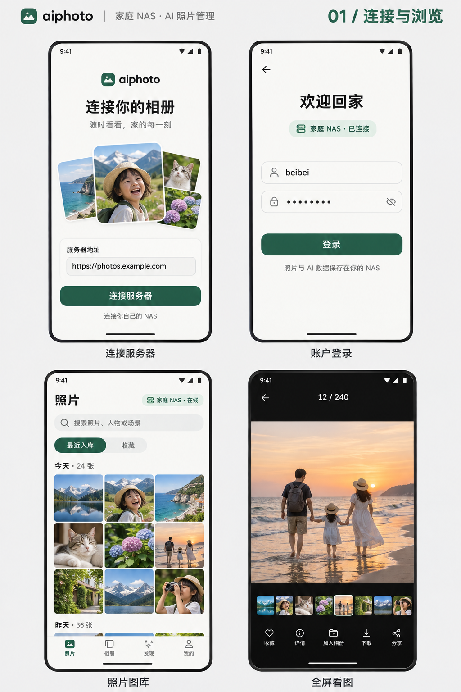

### 15.2 搜索与相册

页面：AI 搜索、组合筛选、相册列表、相册详情。

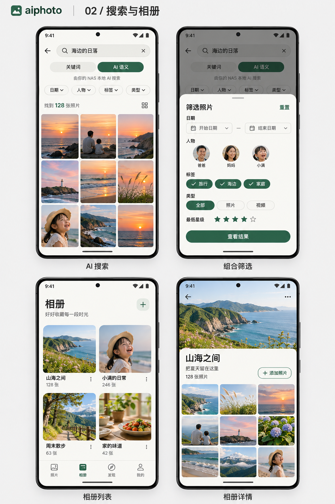

### 15.3 人物与家庭记忆

页面：发现、人物照片、精选时间线、宝宝相册；后两项属于 M2。

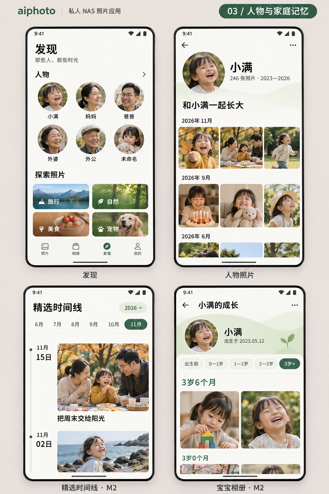

### 15.4 收藏与个人设置

页面：收藏照片、回收站恢复、我的、外观与缓存。

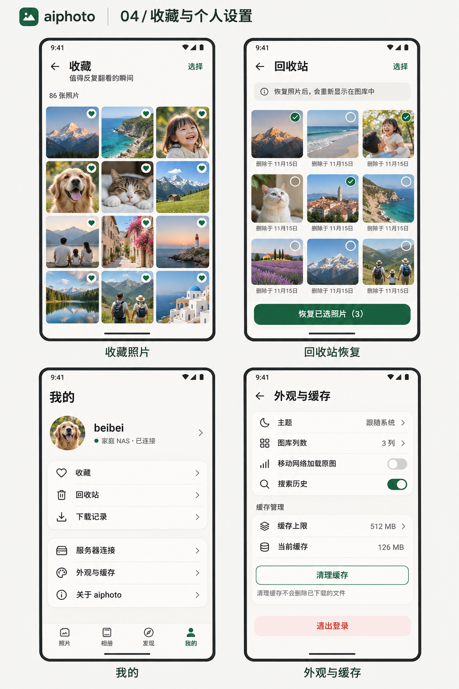

### 15.5 详情与操作

页面：视频播放、照片详情与编辑、创建相册、下载记录。

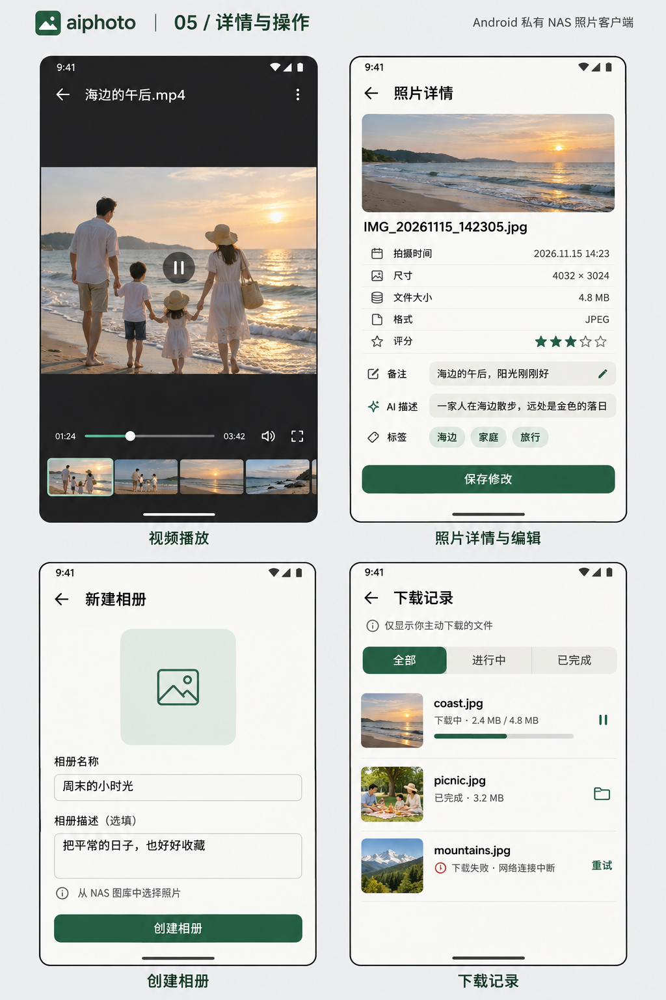

### 15.6 安卓采集中心

2026-11-24 确认新版导航。下方静态图记录采集中心初版布局，最新细节以网页交互原型为准。图中照片与任务均为演示数据。小米 17 Pro Max 的系统安全区与手势冲突留待实机验收。

[直接打开采集概览](assets/android-ui/capture-center/prototype.html#01-overview)。从底部主导航或「我的」进入采集中心后，概览的返回按钮会回到原页面。

#### 概览

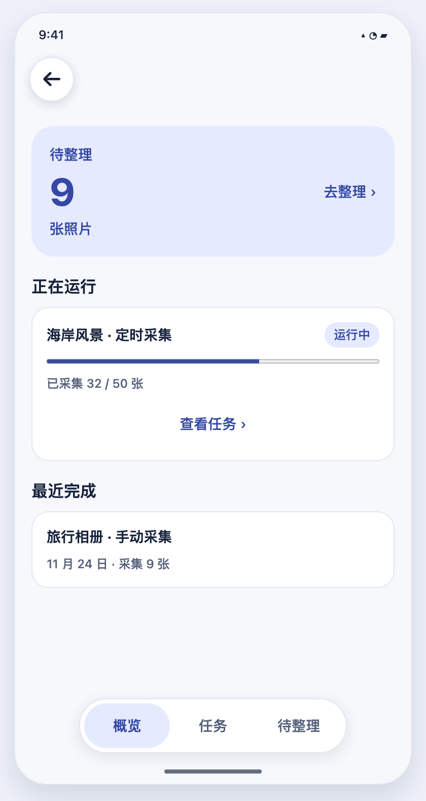

#### 任务列表

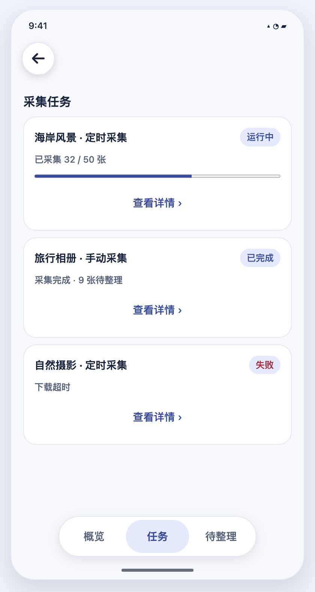

#### 任务详情

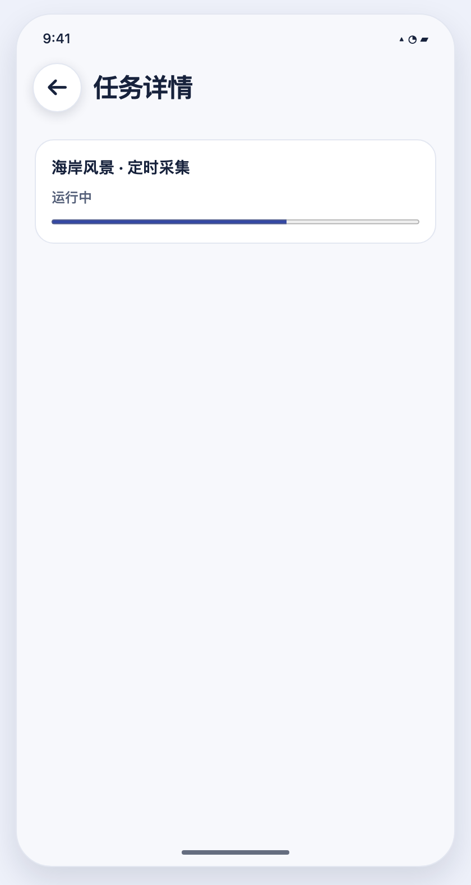

#### 待整理

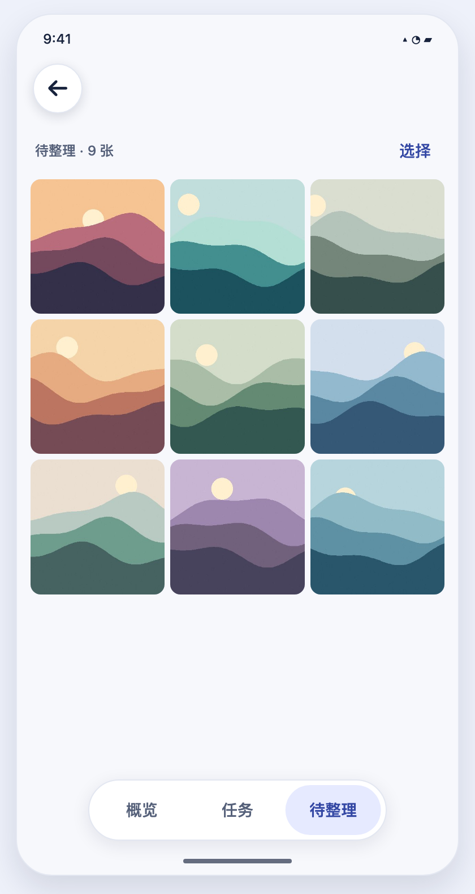

#### 批量多选

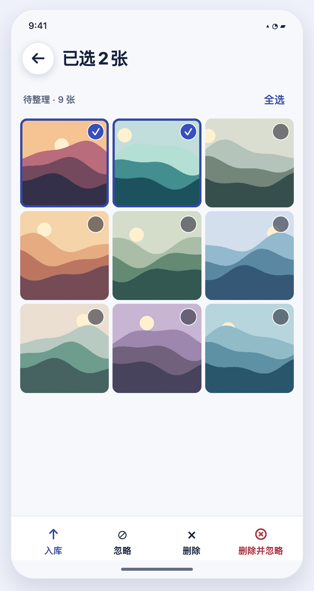

#### 全屏预览

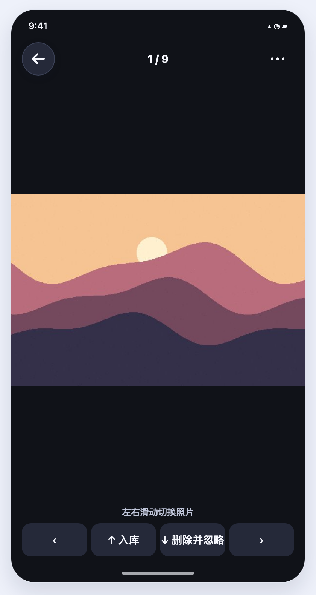

## 16. 首版实现状态（0.22.0）

2026-11-16 新增 `android/` 原生工程，按本文 M1 范围交付可安装调试 APK。参考第 15 节视觉方向实现四个主导航与核心操作页；设计图是效果参考，真实界面使用 NAS 数据，不内置示例照片。

| 范围 | 当前实现 |
| --- | --- |
| 连接与登录 | 服务能力检查、持久实例 ID、代理前缀、HTTP 显式允许、Keystore 加密令牌、401 处理 |
| 浏览与媒体 | 最近入库游标图库、分页/刷新、缩略图、1600 像素服务端预览、双击/双指缩放、视频播放与后台暂停 |
| 搜索 | 关键词/语义、日期/人物/单标签/类型/评分组合条件、历史记录 |
| 相册 | 普通相册创建编辑、分页、选入 NAS 照片、移除关联、设置封面、删除相册 |
| 人物与发现 | 人物、标签和分类只读浏览及照片列表 |
| 整理与恢复 | 收藏、评分、备注、多选逐项结果、移入回收站、恢复；客户端无永久删除入口 |
| 导出 | 系统保存面板、下载进度/取消/重试、FileProvider 临时分享、原文件元数据提示 |
| 本地数据 | Room 元数据、Coil 图片缓存、离线只读、账户偏好、深浅色、网格列数、清缓存 |
| 服务端准备 | 媒体鉴权与 Web Cookie 兼容、相册分页、能力/实例信息、正确 403/404、视频 Range 回归 |

本次采用现有家庭共享图库模式，登录成员沿用现有编辑/恢复权限，永久删除与清空回收站收紧为管理员权限；没有新增个人图库隔离。收藏、评分、备注仍为图库级语义。安卓展示偏好按实例与账户保存在本机，尚不跨设备同步。

M2 宝宝/精选时间线、人物整理和 M3 高级管理仍属于后续阶段，不计入本次首版完成范围。其他明确边界、安装方式、实际构建及测试命令详见 [安卓工程说明](../android/README.md)。真实 NAS、低版本实机、长时间视频/弱网和大图库性能仍需按第 12 节矩阵做部署验收，不能用构建或 MockWebServer 测试替代。

升级注意：须先部署同版本后端和 Web；旧的匿名 `/media/` 地址升级后需要认证，外部代理不得继续公共缓存。完整服务端与客户端契约见 [首版接口说明](android-client-api.md)。

## 17. 第二阶段家庭功能实现（0.23.0）

2026-11-16 继续实现 M2 的家庭浏览和人物整理部分：

| 功能 | 当前行为 |
| --- | --- |
| 精选时间线 | 发现入口、年/月切换、拍摄日期分组和未知日期独立分页；查看器与多选可加入/移出精选 |
| 宝宝相册 | 创建/编辑生日、封面、NAS 选图、移除关联；按服务端统一年龄标签分页展示 |
| 日期边界 | 覆盖出生前、出生当天、未满月、月末、闰日、周岁和日期未知；修改生日重新计算分组 |
| 人物整理 | 改名、分页选择人脸封面；管理员合并人物、修正归属，明确共享影响及不可一键撤销 |
| 资源与权限 | 认证人脸裁剪预览，成功加载后才可选择；不允许无关人脸/回收站人脸作为封面，后端校验管理员权限 |
| 列表与缓存 | 人物照片数据库分页，成长/日期分组采用稳定列表键；缓存服务器能力以保留离线入口 |

本轮不增加手机相册读取、备份或上传。M2 中标签/分类维护、隐私分享副本尚未实现；M3 管理功能仍为后续候选。第 16 节是 0.22.0 历史记录，最新安装范围以本节及 [安卓工程说明](../android/README.md) 为准。接口与年龄算法见 [API 契约](android-client-api.md)，真实 NAS/多种图片格式/低版本实机仍需部署验收。

## 18. 第二阶段整理与分享实现（0.24.0）

2026-11-17 补齐本轮 M2 标签/分类维护和去元数据分享副本：

- 标签/分类管理：新建、编辑、管理员删除人工词条；AI 标签及系统分类只读，说明共享图库影响。
- 照片整理：看图显示人工/AI 来源，多选逐项添加/移除标签或自建分类，保留失败项供重试。手动标签确认及排除记录在 AI 重建后保留，手动分类不会被自动关联清理删除。
- 分享：原件与副本分别选择。副本为最长边 2048 的 sRGB JPEG，方向烘焙到像素，透明转白底，不复制源 EXIF/XMP/文件名；无法转换时不分享原件作为回退。
- 隐私范围：不处理图片里可见的文字、人脸和水印；视频/GIF/RAW 不支持副本转换。不读取、扫描或备份手机相册。
- 部署：先升级配套服务端 0.24.0，以启用 `label-edit` 和标签排除表；旧功能与旧接口保持兼容，部分 Web 全局修改操作新增管理员或只读限制。

M3 管理扩展仍为后续工作。真实 NAS、大图库、低版本实机及更多原始格式/分享目标应用仍需验收；测试范围见 [验证记录](android-client-verification.md)。
